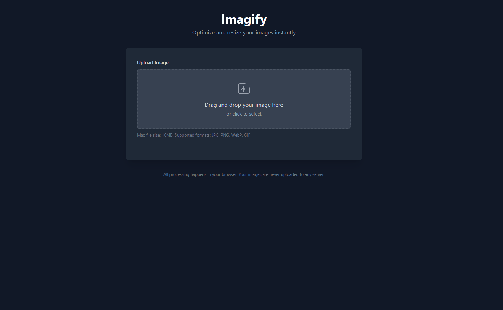
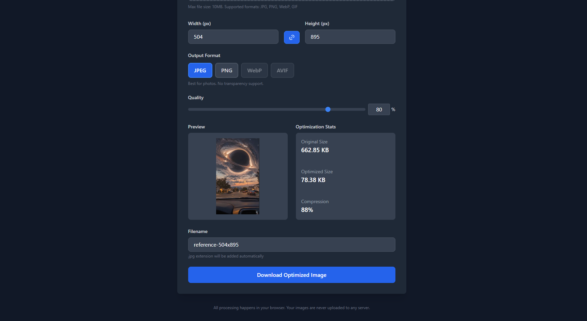

# Imagify — Client-Side Image Optimizer & Thumbnail Generator

**Imagify** is a fast, privacy-first, single-file web application for resizing, compressing, and converting images directly in the browser. Built with vanilla JavaScript, the HTML5 Canvas API, and Tailwind CSS, all image processing happens 100% locally in your browser memory—no images are ever uploaded to a server.

---

## 📸 Screenshots

### Upload Interface


### Live Optimization & Compression Stats


---

## ✨ Key Features

- **100% Client-Side & Private**: Zero backend servers or external API calls. Your images never leave your device.
- **Real-Time Optimization & Preview**: Instantly preview visual quality and compare original vs. optimized file sizes and compression percentages as you adjust settings.
- **Multi-Format Export**: Convert and optimize images into **JPEG**, **PNG**, **WebP**, or **AVIF** (automatically detects browser support for modern formats).
- **Custom Dimensions & Aspect Ratio Lock**: Resize images between `1px` and `10,000px` with an interactive aspect ratio lock toggle to prevent distortion.
- **Precision Quality Control**: Fine-tune compression from `1%` to `100%` using either the interactive range slider or direct numeric input.
- **Smart Validation & Warnings**:
  - Automatic MIME-type validation (`JPG`, `PNG`, `WebP`, `GIF`) and `10MB` maximum file size guard.
  - Visual alerts when an image exceeds `5MB` or when selected settings result in a file larger than the original.
- **Zero-Dependency Deployment**: Shipped inside a single self-contained `index.html` file with dark mode enabled by default.

---

## 📖 How to Use the Web App

1. **Upload an Image**
   - Drag and drop an image (`JPG`, `PNG`, `WebP`, or `GIF`, up to `10MB`) onto the upload zone, or click the box to browse your files.
2. **Adjust Dimensions (`Width` & `Height`)**
   - Upon upload, the original dimensions are automatically populated and the **Aspect Ratio Lock** (link icon between Width and Height) is enabled by default.
   - Enter a new width or height (between `1` and `10,000` pixels). Click the link icon if you want to unlock the aspect ratio and resize width and height independently.
3. **Choose an Output Format**
   - Select **JPEG** (best for photos; fills transparent areas with white), **PNG** (lossless with transparency), **WebP**, or **AVIF** (next-gen compression, enabled automatically if supported by your browser).
4. **Tune Compression Quality**
   - For lossy/configurable formats (`JPEG`, `WebP`, `AVIF`), drag the **Quality** slider or type a percentage (`1%`–`100%`).
   - Watch the **Preview** and **Optimization Stats** panel update in real time. If the new settings increase the file size over the original, a yellow warning indicator (`⚠️`) will appear.
5. **Set Filename & Download**
   - Customize the output filename (defaults to `<original-name>-<width>x<height>`) and click **Download Optimized Image** to save the file with the matching extension.

---

## 🚀 Running Locally

Because Imagify is a self-contained client-side application, no build step or package installation is required.

### Option 1: Open Directly in Browser (Quickest)
1. Clone or download this repository:
   ```bash
   git clone https://github.com/LaylKnight/imagify.git
   cd imagify
   ```
2. Double-click `index.html` to open it in any modern web browser.

### Option 2: Run with a Local HTTP Server (Recommended)
Using a local server mimics a production environment:

- **Using Python:**
  ```bash
  python -m http.server 8000
  ```
  Then open `http://localhost:8000` in your browser.

- **Using Node.js (`npx`):**
  ```bash
  npx http-server -p 8000
  ```
  Then open `http://localhost:8000` in your browser.

---

## 🛠️ Tech Stack

- **Markup & Structure**: HTML5
- **Styling**: Tailwind CSS (via CDN, dark-first UI)
- **Image Processing**: Vanilla JavaScript (ES6+), HTML5 `Canvas` API (`ctx.drawImage`, `canvas.toBlob`), `FileReader` & `Blob` URLs

---

## 📄 License

**Non-Commercial / Personal & Portfolio Use Only**

Copyright © 2026 LaylKnight. All Rights Reserved.

- **Permitted Use**: You are free to view, download, and run this project for personal, educational, and portfolio evaluation purposes.
- **Commercial Restriction**: This software and its source code may **not** be used for commercial, monetization, or for-profit purposes (including integrating it into paid products, commercial services, or ad-supported platforms) without prior written permission.
- **Commercial Inquiries**: For commercial licensing or profitable use inquiries, please contact the author directly via [GitHub (@LaylKnight)](https://github.com/LaylKnight) before use.

See the [LICENSE](./LICENSE) file for full details.
